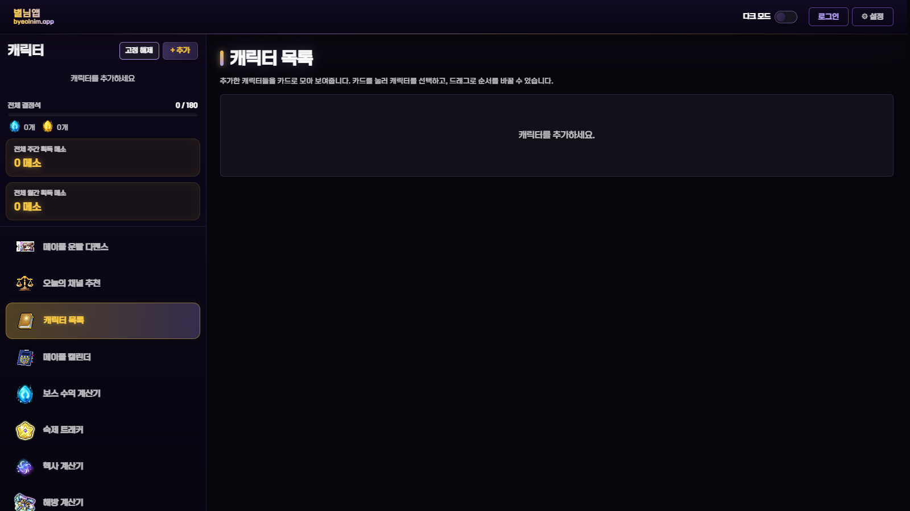
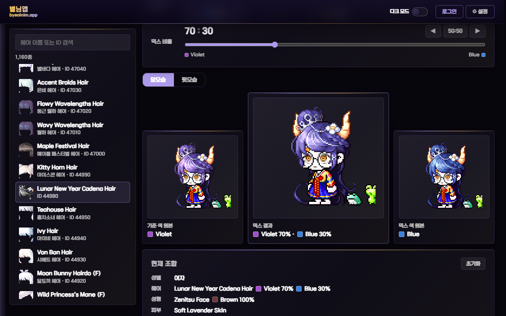
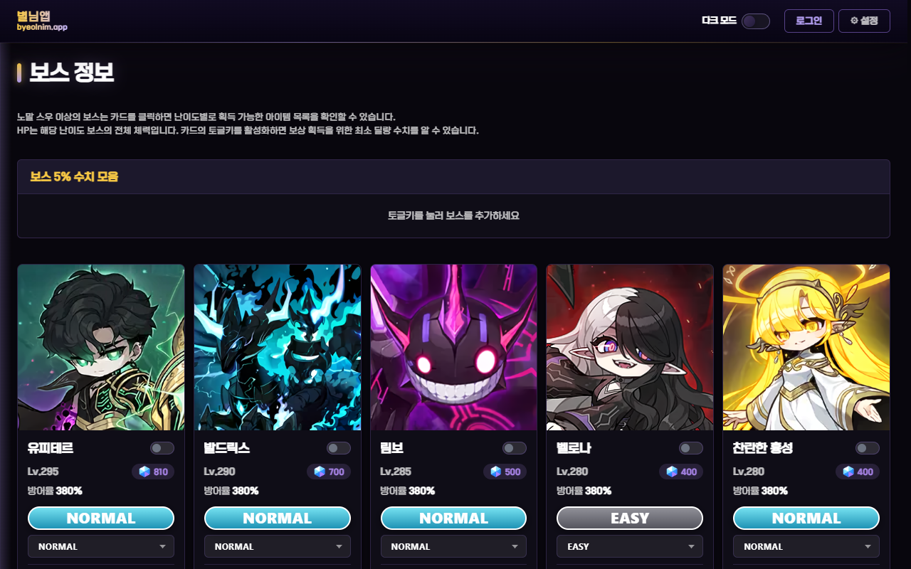
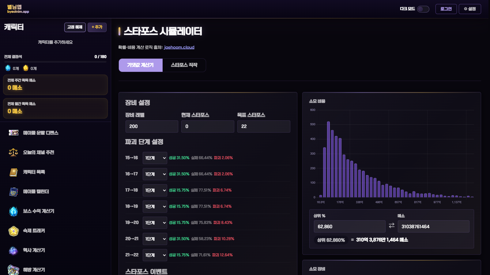
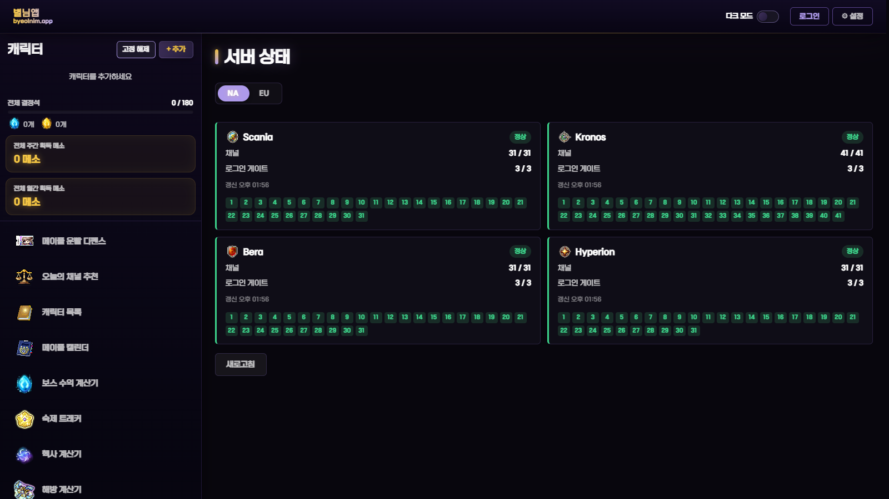

# 별님앱

메이플스토리 GMS 플레이어를 위한 계산기·시뮬레이터·기록 도구 모음 웹앱.

**[byeolnim.vercel.app](https://byeolnim.vercel.app)** · 설치 없이 브라우저에서 사용, 홈 화면에 앱으로 설치 가능



---

## 화면

| 코디 시뮬레이터 | 보스 정보 |
|---|---|
|  |  |

| 스타포스 시뮬레이터 | 서버 상태 |
|---|---|
|  |  |

---

## 주요 기능

### 캐릭터·기록

| 메뉴 | 내용 |
|---|---|
| 캐릭터 목록 | 넥슨 랭킹 조회로 캐릭터 등록, 일별 경험치 기록과 기간별 평균 그래프 |
| 메이플 캘린더 | 캐릭터별 획득 아이템 달력 기록, 보스 일정 푸시 알림 |
| 숙제 트래커 | 캐릭터별 일일 숙제 체크리스트 |
| 오늘의 채널 추천 | 원하는 아이템 선택 시 점검 중이 아닌 채널 무작위 추천 |

### 계산기

| 메뉴 | 내용 |
|---|---|
| 보스 수익 계산기 | 주간·월간 결정석 수익과 결정석 개수 집계 |
| 헥사 계산기 | HEXA 스킬·마스터리·강화·공용 노드 강화 계산 |
| 해방 계산기 | 제네시스 해방 진행과 예상 해방 날짜 계산 |
| 미스틱 프론티어 계산기 | 패밀리어 3마리의 프론티어 잠재 옵션 입력으로 주사위 점수 계산 |

### 시뮬레이터

| 메뉴 | 내용 |
|---|---|
| 코디 시뮬레이터 | 헤어 믹스 염색·성형 믹스 렌즈 비율 미리보기, 피부 선택, 코디 아이템 착용 |
| 추가 옵션 시뮬레이터 | 환생의 불꽃 종류별 추가 옵션 재설정 |
| 스타포스 시뮬레이터 | 단계별 성공·실패·파괴 확률과 비용 기반 강화 시뮬레이션 |
| 큐브 시뮬레이터 | 목표 옵션 기댓값 계산, 직접 큐브 사용 시뮬레이션 |
| 패밀리어 시뮬레이터 | 유니크 패밀리어 옵션 재설정 |
| 소울 증폭 시뮬레이터 | 무기 증폭 단계 강화와 잠재능력 재설정 |
| 연마석 시뮬레이터 | 생명·신념의 연마석 등록 개수별 성공률 시뮬레이션 |

### 정보·커뮤니티

| 메뉴 | 내용 |
|---|---|
| 보스 정보 | 보스별 난이도·HP 카드 |
| 서버 상태 | 월드·채널 상태와 점검 정보 |
| 커뮤니티 | 게시판, 댓글, 사진 첨부 |
| 메이플 운빨 디펜스 | Night Troupe 치트시트 한국어판 |

### 공통

- 회원가입·로그인, 서버 저장·불러오기
- 앱 설치 안내 배너, 푸시 알림
- 다크·화이트 모드

---

## 기술 스택

| 영역 | 사용 기술 |
|---|---|
| 프론트엔드 | 바닐라 JavaScript, HTML, CSS · 번들러·프레임워크 미사용 |
| 호스팅·서버 | Vercel 정적 호스팅, `api/*.js` 서버리스 함수 |
| 데이터베이스 | Upstash Redis · 계정, 게시판, 경험치 스냅샷, 푸시 구독 |
| 파일 저장소 | Vercel Blob · 커뮤니티 사진. 코디 시뮬레이터 층 데이터는 저장소 정적 파일 |
| 예약 작업 | Vercel Cron 일 1회 수집, 외부 크론 서비스의 분 단위 푸시 발송 호출 |
| 알림 | Web Push API, VAPID |
| 앱 설치 | PWA manifest, 서비스 워커 |

---

## 설계

### 1. 외부 데이터 수집 파이프라인

GMS용 넥슨 공식 API 부재. 넥슨 홈페이지 랭킹·서버 상태 화면이 쓰는 인증 없는 엔드포인트 `www.nexon.com/api/maplestory/no-auth/...`를 주기적으로 조회·적재하고, 조회 시점에 가공하는 ELT 구조.

```
[Extract]   api/_lib.js가 넥슨 홈페이지 no-auth 엔드포인트 조회
     ↓
[Load]      가공 없이 Redis에 시간순 스냅샷 적재 · 레코드당 최근 N개만 유지하는 롤링 버퍼
     ↓
[Schedule]  Vercel Cron이 매일 1회 추적 대상 전체 재조회 · api/collect.js, 시크릿 인증
     ↓
[Transform] api/history.js가 응답 시점에 구간별 변화량 계산
```

롤링 버퍼 적재 · `api/_lib.js`

```js
async function pushSnapshot(redis, key, snap) {
  let arr = [];
  const raw = await redis.get('hist:' + key);
  if (raw) arr = typeof raw === 'string' ? JSON.parse(raw) : raw;
  if (!Array.isArray(arr)) arr = [];
  const last = arr[arr.length - 1];
  if (last && last.date === snap.date) arr[arr.length - 1] = snap;
  else if (!last || last.exp !== snap.exp || last.level !== snap.level || last.img !== snap.img) arr.push(snap);
  arr = arr.slice(-180);
  await redis.set('hist:' + key, JSON.stringify(arr));
  return arr;
}
```

- **같은 날 갱신, 변화 없으면 생략**: 하루 한 건만 남기고, 경험치·레벨·이미지가 그대로면 적재하지 않아 버퍼 낭비 방지.
- **CORS 우회**: 브라우저의 넥슨 도메인 직접 호출은 CORS에 차단됨. 서버리스 함수가 대신 호출하는 프록시 구조로 해결.
- **오픈 프록시 방지**: 이미지 프록시 `api/img.js`는 넥슨 도메인만 허용.
- **규모**: 레코드당 스냅샷 최대 180개 수준의 소규모 구조. 대용량 데이터 웨어하우스의 ELT 패턴을 작은 규모에 적용한 사례.

### 2. 코디 시뮬레이터 · 캐릭터 직접 조립

외부 렌더 서버에 의존하던 캐릭터 그림을, 수집한 게임 그림 층으로 브라우저에서 직접 조립하는 구조.

- **문제**: maplestory.io 캐릭터 렌더는 처음 요청받는 조합에서 응답이 느리거나 실패. 서버 상태에 따라 수십 초 대기 발생.
- **수집**: 헤어·성형·코디템마다 앞모습·뒷모습 첫 프레임의 층만 추출. 아이템 100개를 파일 하나로 묶어 약 200MB, 480개 파일로 정리.
- **배포**: 묶음 파일을 저장소에 커밋해 사이트와 같은 주소의 정적 파일로 제공. 처음엔 Vercel Blob에 올렸으나, 업로드 한도와 토큰 입력 단계가 없는 정적 파일로 전환. 묶음은 30일, 색인은 1시간 브라우저 캐시.
- **조립 규칙**: 게임 데이터의 zmap으로 층 순서, smap과 아이템 슬롯으로 모자에 눌리는 머리 같은 가림 처리, 배꼽·목·이마 연결점으로 위치 계산.

가림 처리 · `mixdye_layer.js`

```js
// 슬롯마다 마지막으로 차지한 아이템이 주인. 렌더 서버도 요청 순서를 따름
const owner = {};
items.forEach((it, rank) => it.v.forEach(s => { owner[s] = rank; }));
// 층이 쓰는 슬롯 중 자기 슬롯을 다른 아이템에 빼앗기면 그 층을 숨김
const shown = layers.filter(L => {
  const slots = (rules.smap[L.l[0]] || '').match(/../g) || [];
  return !slots.some(s => L.v.includes(s) && owner[s] !== L.rank);
});
```

위치 계산 · 몸 층을 원점에 두고 이미 정해진 연결점을 가진 층부터 차례로 연결

```js
const place = (L, x, y) => {
  L.x = x; L.y = y;
  for (const [k, [mx, my]] of Object.entries(L.l[3])) if (!(k in anchor)) anchor[k] = [x + mx, y + my];
  placed.push(L);
};
```

- **검증**: 무작위 코디 조합을 앞뒤로 조립해 maplestory.io 렌더와 픽셀 단위 비교. 반투명 가장자리의 반올림 차이만 남는 수준까지 규칙 보정.
- **점진 전환**: 조립할 수 없는 장면은 렌더로 대체. 한 장면 안에서 두 방식을 섞지 않아 믹스 염색 계산 결과 유지.
- **관련 파일**: `mixdye_layer.js`, `tools/coordi_*.js`, 설계 문서 `COORDI_DESIGN.md`

### 3. 무료 플랜 제약 대응

- **서버리스 함수 개수 제한**: Vercel Hobby 플랜 한도 12개. 인증·게시판처럼 기능이 많은 엔드포인트는 함수 하나에서 `action` 값으로 분기.

```js
// api/auth.js · 회원가입, 로그인, 비밀번호 변경, 저장, 불러오기를 함수 하나로 처리
const action = String(body.action || '');
if (action === 'signup') { /* ... */ }
if (action === 'login')  { /* ... */ }
if (action === 'save')   { /* ... */ }
if (action === 'load')   { /* ... */ }
```

- **크론 주기 제한**: Vercel 무료 크론은 하루 1회. 분 단위가 필요한 보스 알림은 외부 크론 서비스가 `api/push-tick.js`를 호출하는 구조.
- **첫 로딩 부담**: 1MB가 넘는 큐브 확률표는 큐브 메뉴를 처음 열 때만 불러오는 지연 로딩.

```js
// cube.js · 받는 중이면 같은 Promise를 재사용해 중복 요청 방지
if (!_cubeTableLoading) {
  _cubeTableLoading = new Promise((resolve, reject) => {
    const s = document.createElement('script');
    s.src = 'cube_table.js?v=20260819b';
    s.onload = resolve;
    s.onerror = () => reject(new Error('cube_table.js 로드 실패'));
    document.body.appendChild(s);
  });
}
```

### 4. 확률 데이터 관리 원칙

- 근거 자료로 확인한 값만 사용. 확률표가 없는 패밀리어 에픽·레어 재설정, 미스틱 프론티어 옵션 확률 같은 기능은 열지 않음.
- 추정치는 데이터 파일 주석에 명시해 확정값과 구분.
- 검증되지 않은 수치로 배포했던 하이퍼스탯 최적화 기능은 내리고 보관.

### 5. 회고

- 번들러 없는 구조로 배포 속도를 우선한 선택.
- 화면 수가 늘면서 상태 관리가 파일마다 흩어지는 한계 경험. 다시 설계한다면 TypeScript와 컴포넌트 단위 상태 관리 도입.

---

## 폴더 구조

```
GMS_Calc/
├─ GMS_WEEK_BOSS/          웹앱 본체 · Vercel 배포 루트
│  ├─ index.html           단일 페이지
│  ├─ common.js            공통 도우미 · 이스케이프, 지연 로딩, 단축키, 자동 실행
│  ├─ app.js               상태 저장, 메뉴 이동, 보스 수익 계산
│  ├─ character.js         캐릭터 추가·조회, 캐릭터 목록 화면, 카드 그림 저장
│  ├─ settings.js          설정, 백업, 테마·글꼴, 관리자 알림
│  ├─ home.js              첫 화면 · 머리 영역, 주요 기능 슬라이드, 전체 메뉴
│  ├─ *.js                 메뉴별 기능 · cube.js, mixdye.js, starforce.js 등
│  ├─ data_*.js            메뉴별 데이터
│  ├─ api/                 서버리스 함수
│  ├─ tools/               데이터 생성·수집 스크립트
│  ├─ serve.js             로컬 개발 서버
│  └─ sw.js, pwa.js        서비스 워커, 앱 설치
├─ .github/workflows/      코디 데이터 수동 수집 작업
└─ COORDI_DESIGN.md        코디 시뮬레이터 설계 문서
```

---

## 로컬 실행

```bash
node GMS_WEEK_BOSS/serve.js
```

`http://localhost:3001` 접속. 정적 파일과 `api/` 함수 전체를 Vercel과 같은 방식으로 로컬 제공.

## 배포

- `master` 브랜치 푸시 시 Vercel 자동 배포. 자세한 절차는 [GMS_WEEK_BOSS/README_DEPLOY.md](./GMS_WEEK_BOSS/README_DEPLOY.md)
- 스크립트·스타일 수정 시 `index.html`의 `?v=` 캐시 버전 갱신
- 필요한 환경 변수

| 변수 | 용도 |
|---|---|
| `UPSTASH_REDIS_REST_URL`, `UPSTASH_REDIS_REST_TOKEN` | Redis 연결 |
| `BLOB_READ_WRITE_TOKEN` | 커뮤니티 사진 Vercel Blob 업로드 |
| `VAPID_PUBLIC_KEY`, `VAPID_PRIVATE_KEY` | 푸시 알림 |
| `CRON_SECRET` | 예약 작업 호출 인증 |
| `ADMIN_SECRET`, `ADMIN_IDS` | 관리자 기능 |

---

## 데이터 출처

- 넥슨 홈페이지 no-auth 엔드포인트 · 랭킹, 서버 상태, 점검 정보
- [maplestory.io](https://maplestory.io) · 아이템 데이터, 캐릭터 렌더, 게임 그림
- [jaehoom.cloud](https://jaehoom.cloud) · 스타포스 확률·비용 계산 로직
- [Night Troupe](https://nighttroupe.netlify.app) · 메이플 운빨 디펜스 치트시트 원본
- [MapleStory Wiki](https://maplestorywiki.net), [masonym.dev](https://masonym.dev) · 미스틱 프론티어 규칙과 옵션 표기

게임 그림과 데이터의 권리는 NEXON에 있음. 비영리 개인 프로젝트.
